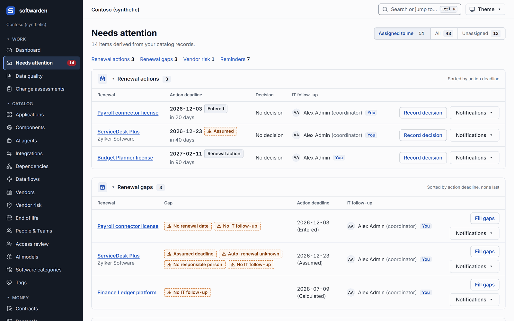

# Softwarden

**Know every app your IT team runs, who owns it, and what needs attention.**

Softwarden is a free, open-source catalog for the software, SaaS, integrations and AI agents in your organization.
It keeps track of owners, reviews, contracts and renewals, and tells you what's missing so nothing slips through.
Think of it as NetBox for software.

<picture>
  <source media="(prefers-color-scheme: dark)" srcset="docs/images/needs-attention-dark.png">
  <source media="(prefers-color-scheme: light)" srcset="docs/images/needs-attention.png">
  
</picture>

The *Needs attention* page with the demo data. To see the rest, [take the tour](docs/TOUR.md).

## Why Softwarden?

Most teams keep their app list in a spreadsheet that's out of date a week after someone writes it. Softwarden keeps
it current:

- **Everything has an owner.** Every app has an owner, a support team and a review date.
- **Gaps come to you.** A missing owner, an overdue review or a renewal with no decision lands on one
  *Needs attention* page.
- **Discovery helps, but you decide.** Softwarden reads Microsoft Entra and other sources and suggests changes.
  It never overwrites what you've entered.
- **Renewals don't sneak up on you.** It tracks contracts, licenses and notice periods, and reminds you by email,
  Teams or webhook.
- **It's yours.** It's self-hosted, with no data leaving your network except to the services you connect.

## Try it

You need Docker with Compose v2.

```bash
git clone https://github.com/Softwarden/softwarden.git && cd softwarden
docker compose up -d --build
docker compose exec app python manage.py bootstrap_admin
```

The last command prints a one-time setup link. Open it at `https://localhost/setup`, accept the local certificate,
and create your organization and first admin. On Windows you can run `scripts/setup.ps1` instead; on Linux or macOS,
`sh scripts/setup.sh`.

Ready to run it for real? The [install guide](https://softwarden.dev/docs/install/) covers a server with your own
domain, certificates and backups.

## What's included

- **Catalog:** apps, components, integrations and AI agents, plus people, teams, vendors, tags and custom fields
- **Contracts and renewals:** costs, license pools, renewal deadlines, spend reports and a calendar feed
- **Reminders:** email, Microsoft Teams and signed webhooks, with a daily digest
- **Discovery:** Microsoft Entra apps, owners, expiring credentials, licenses, shadow IT and SSO coverage, plus Azure,
  Power Platform and HaloITSM
- **Discovery assistant:** Claude suggests how to handle what discovery finds, with your own API key and a monthly cap
- **Governance:** an audit log with CSV and SIEM (JSON lines) export, and an optional compliance profile
- **Sign-in:** local accounts with two-factor, single sign-on (Entra ID, Okta, Google or any OpenID provider),
  and Admin, Editor and Viewer roles
- **For builders:** a REST API, an MCP server for AI assistants, and catalog as code (YAML in git)
- **For operators:** health checks, encrypted backups, a restore drill, light and dark themes, and keyboard-friendly
  screens

All of it is open source. [See every feature](https://softwarden.dev/docs/capabilities/).

## Learn more

📖 **Documentation:** [softwarden.dev/docs](https://softwarden.dev/docs/), with install, configuration, Microsoft
permissions, the API and runbooks.

- [Changelog](CHANGELOG.md): what's in each release
- [Security](SECURITY.md): how to report a vulnerability
- [Development guide](docs/DEVELOPMENT.md): run it from source and run the tests

## Contributing

Contributions are welcome! Start with [CONTRIBUTING.md](CONTRIBUTING.md), and please follow our
[Code of Conduct](CODE_OF_CONDUCT.md).
The website at softwarden.dev, with these docs, lives in [`site/`](site/README.md).

## License

Softwarden is licensed under [Apache 2.0](LICENSE). "Softwarden" is the project's name; please don't use it for a fork
or a hosted service in a way that suggests it's the official project ([details](CONTRIBUTING.md#the-name)).
